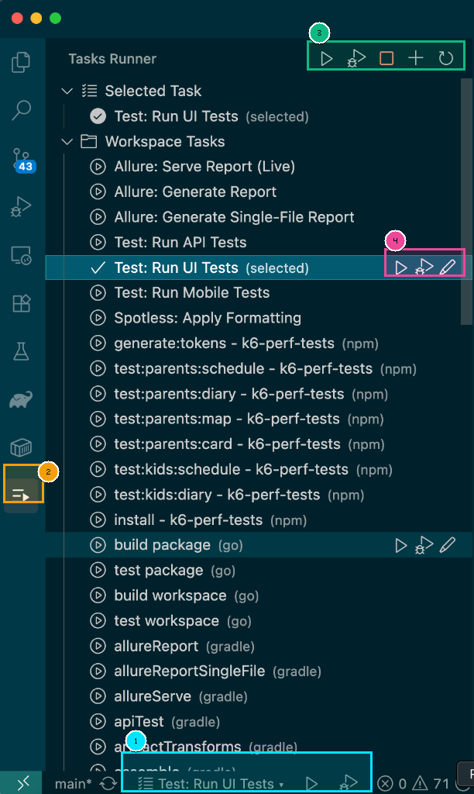

# Task Runner

An IntelliJ IDEA-style Run Configuration and Task Dropdown widget in the status bar and Activity Bar.

> **Note**: **Task Runner** was initially created for **Antigravity IDE** to bring a native, seamless run-configuration and task-execution workflow to the Antigravity AI-first development environment. It is also **100% compatible with Visual Studio Code** (v1.85.0+) and other VS Code-compatible editors (Cursor, Windsurf, VSCodium).

---

## Visual Overview



### Marked UI Elements

| Callout | Component | Description |
|:---:|---|---|
| **①** | **Status Bar Task Widget** | Quick task dropdown selector (`Test: Run UI Tests ▾`), one-click **Play** (`▷`) to run the active task, and **Debug** (`▷🐞`) button linked to `launch.json`. Automatically switches to **Stop** (`□`) while running. |
| **②** | **Activity Bar Icon** | Dedicated Tasks Runner container icon in the primary navigation bar for instant access to the task explorer panel. |
| **③** | **Header Toolbar Controls** | Top action controls to **Run Selected Task** (`▷`), **Debug Selected Task** (`▷🐞`), **Stop Running Task** (`□`), **Add New Task** (`+`), and **Refresh Tasks** (`↻`). |
| **④** | **Inline Task Row Actions** | Hover over any task in the sidebar to reveal quick inline buttons: **Run Task**, **Debug Task**, and **Edit in tasks.json** (`✎`). |

---

## Capabilities

### 1. Status Bar Quick Runner Widget
- **Active Task Dropdown**: Displays the active workspace task (`$(checklist) <Task Name> ▾`) or a prompt to select one (`$(checklist) Select Task ▾`).
- **QuickPick Task Switcher**: Clicking the dropdown opens an interactive menu listing all configured workspace tasks and auto-detected toolchain tasks, complete with execution status indicators (`$(sync~spin)` for active running tasks, `$(pass-filled)` for selected tasks).
- **Dynamic Play / Stop Toggle**: Shows `$(play)` to run the active task when idle; dynamically switches to `$(debug-stop)` to terminate task execution while a task is running.
- **Integrated Debug Launcher**: Shows `$(debug-alt)` to start debugging sessions from `.vscode/launch.json` that match the active task.

### 2. Activity Bar & Sidebar Explorer View
- **Dedicated Sidebar View Container**: Adds a clean "Tasks Runner" container in the Activity Bar.
- **Structured Task Categories**:
  - **Selected Task**: Always displays the currently active task with real-time status indicators (`(running)` / `(selected)`).
  - **Workspace Tasks**: Configured tasks defined across `.vscode/tasks.json` in all opened workspace folders.
  - **Detected Tasks**: Auto-discovered tasks provided by build systems, toolchains, and package managers (e.g. npm, Gradle, Go, Cargo, Make).
- **Header Toolbar**: Run, debug, or stop the selected task, launch the task creation wizard, or refresh task discovery with a single click.
- **Inline Task Actions**: Run, debug, or jump to code definitions directly from individual task rows on hover.

### 3. Interactive Task Creation Wizard
- **4-Step Guided Flow**:
  1. **Task Name**: Enter a descriptive label (e.g. `Build`, `Test`, `Start Dev Server`).
  2. **Command**: Enter the executable or script (e.g. `npm run build`, `cargo check`, `./scripts/test.sh`).
  3. **Execution Type**: Choose between `shell` (runs inside bash/zsh/PowerShell) or `process` (runs executable directly).
  4. **Task Group**: Optionally assign task to the `build` or `test` group with default execution flags.
- **Automatic Configuration**: Automatically formats and inserts the new task into `.vscode/tasks.json` and immediately sets it as the active task.

### 4. Multi-Root Workspace Support
- Automatically detects multi-root workspace environments.
- Prompts for target workspace folder when creating tasks or navigating configuration files, ensuring proper folder scoping.

### 5. Direct Configuration Navigation
- Jump directly to task definitions inside `.vscode/tasks.json` with cursor positioning on the matching line.
- Seamlessly link to debug configurations inside `.vscode/launch.json`.

---

## Packaging & Installation

### Step 1: Create the VSIX Package
Build the extension package from source using the packaging script in `package.json`:

```bash
npm run package
```

*(This runs `npx @vscode/vsce package --allow-star-activation` and generates `tasks-runner-0.0.2.vsix` in the project root).*

### Step 2: Install from VSIX via GUI
Install the generated `.vsix` file into **Antigravity IDE** or **VS Code**:

1. Open the **Extensions** view (`Ctrl+Shift+X` on Windows/Linux, `Cmd+Shift+X` on macOS).
2. Click the **`...`** (Views and More Actions) menu in the top-right corner of the Extensions panel.
3. Select **Install from VSIX...**.
4. Browse to and select the generated `tasks-runner-0.0.2.vsix` file.
5. The extension activates immediately and adds the Tasks Runner widget to your status bar and Activity Bar.

---

## Extension Settings

Customize Task Runner behavior via VS Code / Antigravity settings (`settings.json`):

| Setting | Type | Default | Description |
|---|:---:|:---:|---|
| `taskRunner.showStatusBarWidget` | `boolean` | `true` | Show the task dropdown selector and run/stop/debug controls in the status bar. |
| `taskRunner.showActivityBarView` | `boolean` | `true` | Show the dedicated Tasks Runner icon and sidebar view in the Activity Bar. |
| `taskRunner.showDebugButton` | `boolean` | `true` | Show the debug button next to the play button in the status bar. |
| `taskRunner.statusBarPriority` | `number` | `100` | Priority order of the task dropdown items in the status bar. |

---

## Commands Reference

All commands are accessible via the Command Palette (`Ctrl+Shift+P` / `Cmd+Shift+P`):

| Command ID | Title | Description |
|---|---|---|
| `tasksWidget.selectTask` | Tasks Widget: Select Task | Opens the task selector QuickPick dropdown. |
| `tasksWidget.runSelectedTask` | Tasks Widget: Run Selected Task | Runs the active task, or prompts for selection if none selected. |
| `tasksWidget.stopSelectedTask` | Tasks Widget: Stop Selected Task | Terminates the active running task process. |
| `tasksWidget.debugSelectedTask` | Tasks Widget: Debug Selected Task | Launches matching debug configuration from `launch.json`. |
| `tasksWidget.addNewTask` | Tasks Widget: Add New Task | Launches interactive 4-step wizard to define a new task in `tasks.json`. |
| `tasksWidget.editTask` | Tasks Widget: Edit Task in tasks.json | Opens `tasks.json` and navigates to the selected task definition. |
| `tasksWidget.configureTasks` | Tasks Widget: Configure tasks.json | Opens `.vscode/tasks.json` for manual editing. |
| `tasksWidget.refreshTasks` | Tasks Widget: Refresh Tasks | Refreshes discovered and configured tasks in the sidebar view. |
| `tasksWidget.runTreeTask` | Tasks Widget: Run Task | Runs the clicked task from the sidebar tree view. |
| `tasksWidget.debugTreeTask` | Tasks Widget: Debug Task | Starts debugging for the clicked task from the sidebar tree view. |
| `tasksWidget.editTreeTask` | Tasks Widget: Edit Task in tasks.json | Jumps to task line in `tasks.json` from the sidebar tree view. |

---

## Requirements

- **Antigravity IDE** or **Visual Studio Code** version `1.85.0` or higher.
